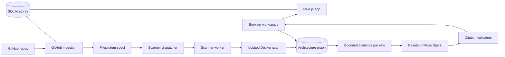

# 🏛️ CodeArchaeologist AI

**Evidence-grounded AI repository intelligence for understanding unfamiliar and legacy codebases.**

CodeArchaeologist AI scans repositories into structural architecture graphs and lets developers explore modules, features, relationships, and source evidence — then reasons about the codebase with AI answers that are validated against cited evidence. Browser directory scans stay in the browser; server-side GitHub scans run in isolated Docker containers through a privilege-separated worker handoff.

Built for the **Meta AI Developer Hackathon — Indie Developer Track: Push the Frontier**.

## 🎯 Problem Statement

Undocumented legacy systems hide critical knowledge: architecture nobody mapped, dependencies nobody traced, business rules buried in aging code, and workflows only former developers understood. Traditional tools report syntax and vulnerabilities but rarely explain *why* software behaves as it does — and AI assistants without grounding confidently invent files, behavior, and citations that do not exist.

## 💡 Solution

CodeArchaeologist AI combines deterministic static analysis with strictly validated AI reasoning:

- **Isolated repository scanning** of local directories and GitHub repositories into bounded architecture graphs.
- **Structural analysis** for PHP and JavaScript, including framework route adapters and cross-stack call tracing.
- **Architecture exploration**: modules, features, relationships, business rules, and source-grounded evidence navigation.
- **Workflow investigation**: autonomous multi-step investigations and an assistant that answers with citations.
- **Source-grounded AI reasoning**: every AI claim must cite submitted evidence IDs; responses that mention unsupported paths, invent citations, or include unsafe text are rejected before they reach the user.

## ✨ Key Features

- **Repository Intelligence workspace** (`/`): scan a local directory, import graph JSON, or analyze a GitHub repository; explore the resulting graph. `/architecture` redirects here for existing bookmarks.
- **Local-first scanning**: browser directory scans never leave the browser; a CLI alternative (`npm run archaeology:scan`) scans from the terminal.
- **GitHub ingestion**: controlled public repository scans plus GitHub App sign-in with installation-token access for selected private repositories.
- **Isolated server scanner**: Docker execution with a fixed image, rootless daemon, seccomp enforcement, no network, read-only mounts, and strict resource caps.
- **Privilege-separated worker handoff**: a filesystem spool with distinct web/worker Unix identities, atomic claims, acknowledgements, heartbeats, and single-use dispatch markers.
- **Architecture graph**: components, relationships, business-rule patterns, framework route adapters (CodeIgniter, Laravel), and frontend-to-PHP call correlation.
- **Repository Overview AI**: packet-grounded Q&A with exact `path:line` citation rules and a bounded validation-feedback retry.
- **Feature interpretation and chat**: per-feature explanations and follow-up questions against the same evidence.
- **Autonomous investigation**: goal-directed agent with validated tool calls and evidence-anchored final reports.
- **Architecture Health advisor**: deterministic findings plus conservative AI observations tied to finding IDs.
- **Legacy Pricing example** (`/examples/legacy-pricing`): trusted end-to-end investigation demo with report generation and offline reverification.
- **Durable job stores**: SQLite-backed sessions, jobs, dispatches, quotas, and artifacts with retention and lease handling.

## ⚙️ How It Works

1. **Acquisition**: local directories are read in the browser; GitHub repositories are fetched server-side with installation tokens into private staging directories (at most 300 files, 2 MB per file, 12 MB total).
2. **Isolated scanning**: source snapshots are verified by hash, copied into a worker-private directory, and scanned inside a networkless Docker container that returns graph JSON on stdout.
3. **Graph generation**: PHP (`php-parser`) and JavaScript (`@babel/parser`) analysis produces components, edges, routes, rules, and coverage metadata (artifacts capped at 5 MB).
4. **Evidence collection**: bounded evidence packets are derived from the graph (repository packets: at most 40 references within 16 KB; no source bodies, only paths and line references).
5. **AI investigation**: packets plus a bounded question are sent to Meta Muse Spark via Baseten; structured JSON responses are parsed and every citation is validated against the submitted packet before rendering.

## 🧠 AI Integration

- **Model**: Meta Muse Spark, `meta-models/muse-spark-open-1026`.
- **Serving**: Baseten's OpenAI-compatible inference API (`https://inference.baseten.co/v1/chat/completions`), configured via `INVESTIGATION_PROVIDER=baseten`, `BASETEN_API_KEY`, and `BASETEN_MODEL_ID`. A direct Meta Model API adapter is also included for development.
- AWS hosts the application; Baseten serves model inference.
- All provider traffic is server-side with bounded output tokens, durations, quotas, and strict JSON schemas; failures return sanitized diagnostics without model text or credentials.

## 🛠️ Technology Stack

- **Frontend**: Next.js 16 (standalone output), React 19, TypeScript, Tailwind CSS 4
- **Backend**: Node.js 24, TypeScript, Next.js API routes
- **AI**: Meta Muse Spark via Baseten (OpenAI-compatible)
- **Data**: SQLite through `node:sqlite` (sessions, jobs, dispatches, quotas, artifacts)
- **Analysis**: `php-parser`, `@babel/parser`, deterministic framework adapters
- **Isolation**: Docker (rootless, seccomp, networkless containers)
- **Integrations**: GitHub App (OAuth sign-in, installation tokens), GitHub REST/contents APIs
- **Testing**: Vitest, ESLint, `tsc --noEmit`
- **Demo hosting**: AWS Ubuntu host, served behind Nginx as a reverse proxy

## 🏗️ System Architecture



## 🔐 Security

Verified safeguards in this repository:

- **Repository isolation**: server scans run in networkless containers (`--network=none`, read-only mounts, `--user 65534:65534`, dropped capabilities, no-new-privileges, seccomp `builtin` profile verified by probe, fixed image digest, memory/CPU/pids limits).
- **Controlled scanning**: snapshots are hashed and re-verified before execution; manifests pin every file; byte and file-count budgets are enforced.
- **Privilege separation**: web and worker run as distinct Unix users with dedicated spool groups; the worker never receives web secrets, database paths, or provider credentials (allowlisted environment only).
- **Evidence validation**: AI outputs must match strict schemas and cite only submitted evidence IDs; unsupported source references, invented citations, HTML, URLs, and unsafe text are rejected fail-closed.
- **Secrets handling**: credentials live in ignored `.env.local` or deployment secrets (see `.env.example` for placeholders); build tracing excludes environment files, git data, docs, and fixtures.
- **Abuse controls**: same-origin enforcement, explicit AI consent per packet, SQLite rate quotas, daily provider budgets, bounded request/response sizes, and production feature gates that default off.

## 🚀 Live Demo

- **Demo**: https://codearchaeologist.theconduitbox.com
- **Repository**: https://github.com/gevalinho/codearchaeologist-ai
- **Demo video**: https://youtu.be/NFmZknBIAb4

## 💻 Local Development

### Prerequisites

- Node.js `>=24.15.0 <25` and npm
- Git
- Docker (only for server-side isolated scans; browser scans work without it)

### Installation

```bash
git clone https://github.com/gevalinho/codearchaeologist-ai.git
cd codearchaeologist-ai
npm ci
cp .env.example .env.local
```

Edit `.env.local` with your own values — never commit real credentials (`.env.local` is git-ignored).

### Environment variables

See `.env.example` for the full list with placeholders:

- `INVESTIGATION_PROVIDER=baseten` plus `BASETEN_API_KEY` for live AI inference
- `ENABLE_FEATURE_AI=1`, `FEATURE_AI_ORIGIN`, and related flags for AI features
- `GITHUB_APP_*`, `CODEARCH_DB_PATH`, `CODEARCH_TOKEN_ENCRYPTION_KEY` for GitHub App sign-in
- `CODEARCH_ARTIFACT_DIR`, `CODEARCH_STAGING_DIR` for private server state
- `CODEARCH_SPOOL_ROOT`, `CODEARCH_WORKER_SCAN_ROOT`, UID/GID variables for the scanner worker handoff

### Commands

```bash
npm run dev                  # Start the development server
npm run build                # Production build
npm start                    # Serve the production build
npm run lint                 # ESLint
npm run test                 # Vitest suite
npm run typecheck            # TypeScript checks
npm run archaeology:scan     # CLI repository scan
npm run scanner:dispatcher   # Scanner dispatcher (worker identity)
npm run demo:report          # Generate the Legacy Pricing demo report
npm run demo:reverify        # Reverify the demo report offline
```

Browser directory scans stay in the browser; see [archaeology documentation](docs/archaeology.md) for scanner limits and the CLI alternative. Controlled public GitHub scans require the server setup in [GitHub ingestion documentation](docs/github-ingestion.md). GitHub App sign-in and selected private repository scanning are documented in [GitHub App setup](docs/github-app.md).

## ⚠️ Known Limitations

- **Partial source coverage**: scans are capped (300 files, 2 MB per file, 12 MB total); omitted eligible files are reported, and missing components must never be treated as absent features.
- **Unsupported files**: unparsable sources, excluded directories, and non-PHP/JS assets are counted, not analyzed; parser gaps are recorded as limitations.
- **AI inference limitations**: bounded packets (no source bodies), token/time/quota budgets, and strict validators mean some answers legitimately fail closed or return insufficient-evidence.
- **Observed vs inferred**: graph structure is observed evidence; repository purpose, behavior, and modernization advice are model inferences that require source review — never verified runtime facts.

## 🏆 Hackathon

**Event:** Meta AI Developer Hackathon
**Track:** Indie Developer Track — Push the Frontier
**Team:** Gevalinho Labs
**Development Started:** October 27, 2026
**Submission Deadline:** November 4, 2026

## 👥 Author

Gevalinho Labs — Geva-eval Egbe.

## 📄 License

MIT License — see [LICENSE](LICENSE).

---

**Built with curiosity, engineering discipline, and a mission to recover the knowledge hidden inside software.**
